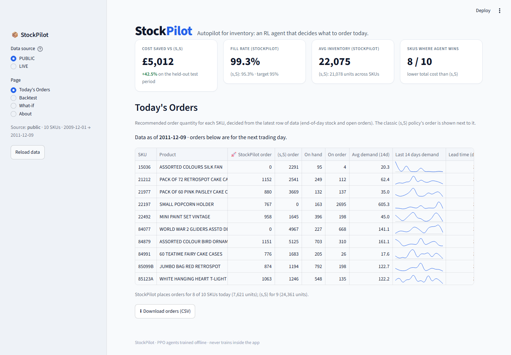
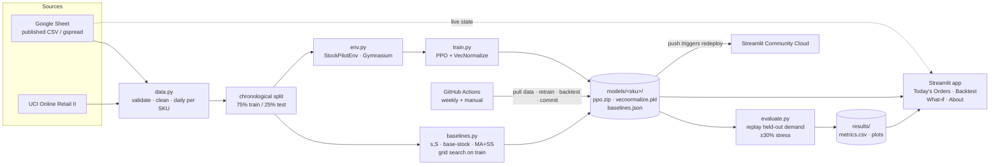

# StockPilot

**Autopilot for inventory: an RL agent that decides what to order today.**

🔗 **Live app:** _added after Streamlit Cloud deployment_ · 📊 Data: [UCI Online Retail II](https://archive.ics.uci.edu/dataset/502/online+retail+ii) or your own Google Sheet



## The problem

Every day, for every product, a shop has to decide how many units to order. Order too little and customers leave
empty-handed (**lost sales**). Order too much and cash sits on shelves (**holding cost**) or expires (**waste**). Order
too often and fixed **ordering costs** add up. StockPilot trains one reinforcement-learning agent per SKU to minimise

> **total cost = holding + ordering + lost sales + waste**, while keeping the fill rate at or above the 95% target,

and proves it against classic inventory rules on **held-out real data**, not on simulated demand.

## Results (held-out test period, real demand)

Data: the 10 best-selling SKUs of UCI Online Retail II (a UK giftware wholesaler). Chronological split: **train
2009-12-01 → 2011-06-15** (75% of trading days), **test 2011-06-16 → 2011-12-09** (151 trading days, including the
Christmas peak). Every policy starts the test with the same stock and sees the same real daily demand. The baselines
were grid-searched and the agents trained and selected using the **training period only**.

| Policy (all 10 SKUs) | Total cost | Fill rate | Avg inventory (units, summed) | Orders placed |
|---|---:|---:|---:|---:|
| **StockPilot PPO** | **£6,779** | **99.3%** | 22,075 | 238 |
| (s,S), grid search | £11,792 | 95.3% | 21,078 | 123 |
| Base-stock | £8,495 | 99.6% | 23,091 | 1,353 |
| Moving average + safety stock | £18,550 | 94.4% | 26,201 | 879 |

**StockPilot beats (s,S) on 8 of 10 SKUs, with 42.5% lower total cost (£5,012 saved), and beats base-stock on 9 of 10.**
Its total is also lower than an *oracle* that picks the best baseline per SKU with hindsight (£7,216).

| SKU | Product | StockPilot | (s,S) | Saving | Fill (agent) | Fill (s,S) | Agent wins |
|---|---|---:|---:|---:|---:|---:|:-:|
| 15036 | Assorted Colours Silk Fan | £542 | £568 | +4.5% | 96.2% | 95.8% | ✅ |
| 21212 | Pack Of 72 Retrospot Cake Cases | £253 | £268 | +5.5% | 100.0% | 100.0% | ✅ |
| 21977 | Pack Of 60 Pink Paisley Cake Cases | £334 | £285 | −17.2% | 100.0% | 100.0% | ❌ |
| 22197 | Small Popcorn Holder | £1,146 | £4,815 | +76.2% | 98.2% | 84.8% | ✅ |
| 22492 | Mini Paint Set Vintage | £353 | £945 | +62.7% | 98.5% | 90.9% | ✅ |
| 84077 | World War 2 Gliders Asstd Designs | £303 | £334 | +9.5% | 100.0% | 98.0% | ✅ |
| 84879 | Assorted Colour Bird Ornament | £1,488 | £2,308 | +35.5% | 100.0% | 97.7% | ✅ |
| 84991 | 60 Teatime Fairy Cake Cases | £231 | £241 | +4.3% | 100.0% | 100.0% | ✅ |
| 85099B | Jumbo Bag Red Retrospot | £1,018 | £894 | −13.8% | 99.4% | 99.6% | ❌ |
| 85123A | White Hanging Heart T-Light Holder | £1,112 | £1,133 | +1.9% | 100.0% | 99.4% | ✅ |

**Stress test** (demand scaled on the test period; no policy re-tuned):

| Scenario | StockPilot | (s,S) | Agent wins |
|---|---:|---:|:-:|
| Demand −30% | £6,062 | £7,678 | 4 / 10 |
| Real demand | £6,779 | £11,792 | 8 / 10 |
| Demand +30% | £14,361 | £19,067 | 7 / 10 |

### Read this honestly
- **Two SKUs still lose to (s,S)**: 21977 (−17%) and 85099B (−14%). Both got two rounds of tuning: action range
  0–4× lead-time demand, three more seeds, and 1.5M steps. The variant kept for each SKU was the one with the
  lowest **training-period** cost, never the best test result, so the test set stays untouched. On these
  steady, high-volume SKUs a well-tuned (s,S) is already near-optimal, and the agent orders more often than it needs to.
- **A large share of the aggregate saving comes from two SKUs** (22197, 84879). There, the (s,S) parameters tuned on
  2010 demand under-stock the larger 2011 peak (fill 85% and 98%). The agent sees the last 14 days of demand and reacts.
  Without those two SKUs the agent still saves 11.2% over (s,S) on the other eight (£4,145 vs £4,668).
- **With 30% less demand the agent wins only 4/10 SKUs.** It was trained at historical demand levels and keeps
  slightly too much stock when demand drops. (s,S) does the same, but less.
- The economics are assumptions: unit cost = 60% of price, 100%/yr carrying cost, £2 per order, stockout penalty =
  lost margin + 50% of price, 3-day lead time. All are configurable in `configs/config.yaml`, and the What-if page lets
  you change them live.

Plots: [`results/cost_comparison.png`](results/cost_comparison.png) ·
[`results/fill_rate_comparison.png`](results/fill_rate_comparison.png) ·
[`results/stock_over_time.png`](results/stock_over_time.png) · raw numbers in [`results/metrics.csv`](results/metrics.csv),
[`results/stress_metrics.csv`](results/stress_metrics.csv), [`results/summary.csv`](results/summary.csv).

## The MDP

| | |
|---|---|
| **Agent** | one PPO policy per SKU |
| **State** | on-hand stock; inventory position; order pipeline (padded to 14 days); lead time; last 14 days of demand ÷ mean; day of week (one-hot). Stock quantities are ÷ (10 × mean demand). |
| **Action** | discrete order quantity, 21 levels from 0 to 3× (4× for some SKUs) mean lead-time demand |
| **Dynamics** | the order arrives after exactly *L* days → demand is served FIFO → unmet demand is lost → optional shelf-life expiry (FIFO lots) → holding cost on end-of-day stock |
| **Reward** | −(holding + fixed ordering + stockout penalty + waste) ÷ (margin × mean demand). This equals daily profit minus margin × demand, a term the agent cannot influence, so it has the same optimal policy as profit with far lower variance. Typical values are in [−1, 0]. |
| **Demand** | training: 7-day block bootstrap of the training period's real daily sales (keeps weekday and short-term autocorrelation), optionally scaled; evaluation: exact replay of real held-out sales |

Training: Stable-Baselines3 PPO, `VecNormalize`, 8 environments, 128×128 MLP, fixed seeds, CPU only,
500k–800k steps (~5 minutes per SKU). Two details mattered:
1. **Initial action bias.** With uniform exploration the agent orders ~4.5× demand per day. Stock then explodes and
   it never sees the states that matter, and the first version learned a constant order that ignored stock. The
   policy head now starts with P(order 0) = 0.9; training is otherwise unchanged.
2. **Checkpoint selection on training data.** Every 5% of training, the policy is replayed on the training
   period and the cheapest checkpoint is kept.

## Architecture



## Repository layout

```
stockpilot/   data.py  env.py  baselines.py  train.py  evaluate.py  simulate.py  recommend.py  config.py
app/          streamlit_app.py            # dashboard: inference only, never trains
tests/        test_env.py  test_data.py  test_app.py
configs/      config.yaml                 # data mode, economics, env, PPO, per-SKU tuning
data/sample/  sample_sales.csv            # bundled sample in the live schema, so the app always runs
data/processed/ daily_public.csv          # cleaned UCI daily data (top 10 SKUs)
models/<sku>/ ppo.zip  vecnormalize.pkl  meta.json  baselines.json
results/      metrics.csv  stress_metrics.csv  summary.csv  traces.csv  *.png
.github/workflows/retrain.yml
```

## Setup and run locally

Python 3.11 is recommended.

```bash
python -m venv .venv
.venv/Scripts/activate          # Windows; on macOS/Linux: source .venv/bin/activate
pip install -r requirements.txt
python -m pytest                # environment, data and dashboard tests
python -m stockpilot.data --mode public       # 1. download + clean UCI data (~1-2 min)
python -m stockpilot.baselines                # 2. tune baselines on the training period
python -m stockpilot.train --all              # 3. train PPO per SKU (~5 min each, CPU)
python -m stockpilot.evaluate                 # 4. backtest + stress test -> results/
streamlit run app/streamlit_app.py            # 5. dashboard
```

Train SKUs in parallel with one process each: `python -m stockpilot.train --sku 85123A`. Try a variant without editing
the config: `--set env.action_max_mult=4 --set ppo.seed=7 --out variants/x`.

## Using your own data (LIVE mode)

Create a Google Sheet with one row per SKU per day:

| date | sku | units_sold | on_hand | unit_cost | price | lead_time_days | on_order (optional) |
|---|---|---|---|---|---|---|---|
| 2026-11-14 | MUG-01 | 12 | 140 | 2.10 | 5.99 | 3 | 60 |

`on_hand` and `on_order` are **end-of-day** values. The app validates the sheet and shows clear errors (missing
columns, bad dates, negatives, duplicates). Publish it: **File → Share → Publish to web → (your sheet) →
Comma-separated values (.csv) → Publish**, then put the link in the secrets (below). SKUs without a trained agent
get a (s,S) recommendation until the next retrain; add the same URL as the `LIVE_CSV_URL` repository secret so the
weekly retrain trains on your sheet. A private sheet can be read with a gspread service account instead (see
[`.streamlit/secrets.toml.example`](.streamlit/secrets.toml.example)).

## Deploy (Streamlit Community Cloud)

1. Go to <https://share.streamlit.io> and sign in with GitHub.
2. Click **Create app** → **Deploy a public app from GitHub**.
3. Repository: `<your-user>/stockpilot` · Branch: `main` · Main file path: `app/streamlit_app.py`.
4. Optional: choose a custom app URL, e.g. `stockpilot`.
5. Open **Advanced settings** → Python version **3.11** → in **Secrets** paste:
   ```toml
   [live]
   csv_url = "https://docs.google.com/spreadsheets/d/e/XXXX/pub?gid=0&single=true&output=csv"
   ```
   (Skip this to run in PUBLIC mode only. Secrets can be added later via **⋮ → Settings → Secrets**.)
6. Click **Deploy**. The first build takes a few minutes (CPU-only torch).

## Automation

[`.github/workflows/retrain.yml`](.github/workflows/retrain.yml) runs every Monday at 03:00 UTC and on demand
(**Actions → Retrain StockPilot → Run workflow**). It runs the tests, pulls the latest data (the live sheet if
`LIVE_CSV_URL` is set, otherwise UCI), re-tunes the baselines, retrains every agent (4 in parallel), re-runs the
backtest and commits `models/` and `results/`. The push makes Streamlit Cloud redeploy automatically.

## Data licence

UCI Online Retail II, Daqing Chen (2012), CC BY 4.0. The dataset has no inventory records, so the historical
`on_hand` in the processed and sample files is simulated. Backtests use only the real demand.
